# Introducing Sai: Nibiru’s Perpetuals DEX

Over the last few years, crypto trading has moved from spot markets to derivatives. Perpetual futures, or perps, now drive most activity, and a new wave of perpetual DEX apps has proven that crypto perpetual futures are the product many traders care about most.

Crypto trading has evolved, but the user experience hasn't kept up. Traders are still forced to choose: the performance of a CEX, or the security of a DEX.

Sai is a decentralized perpetuals platform built to deliver CEX-level performance with an intuitive UX and reliable settlement. The system provides easy access to yield, reinforces collateral and features protection within the trading experience. Traders get a familiar, streamlined workflow, while liquidity providers gain a transparent path to earning from real activity.

<figure>
  <picture>
    <source
      srcset="
        ../.gitbook/assets/blog_1/001_why-sai-slide.png
      "
      media="(prefers-color-scheme: dark)"
    />
    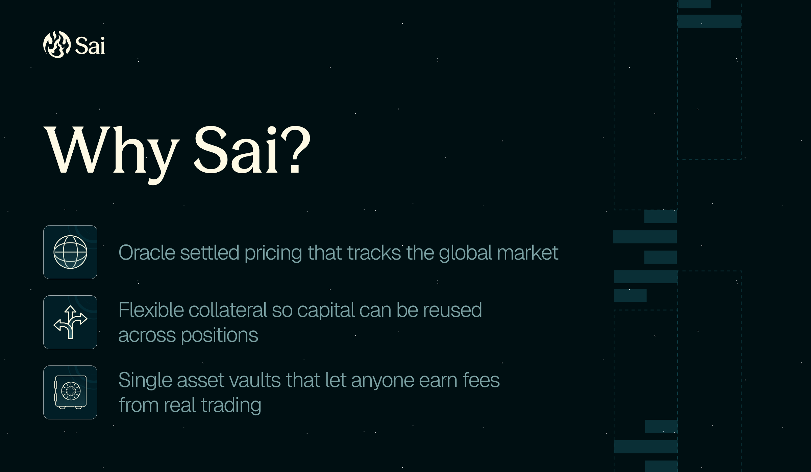
  </picture>
  <figcaption>Trading made simple. Perps without limits.</figcaption>
</figure>

<figure>
  <picture>
    <source
      srcset="
        ../.gitbook/assets/blog_1/002_sai-trading.png
      "
      media="(prefers-color-scheme: dark)"
    />
    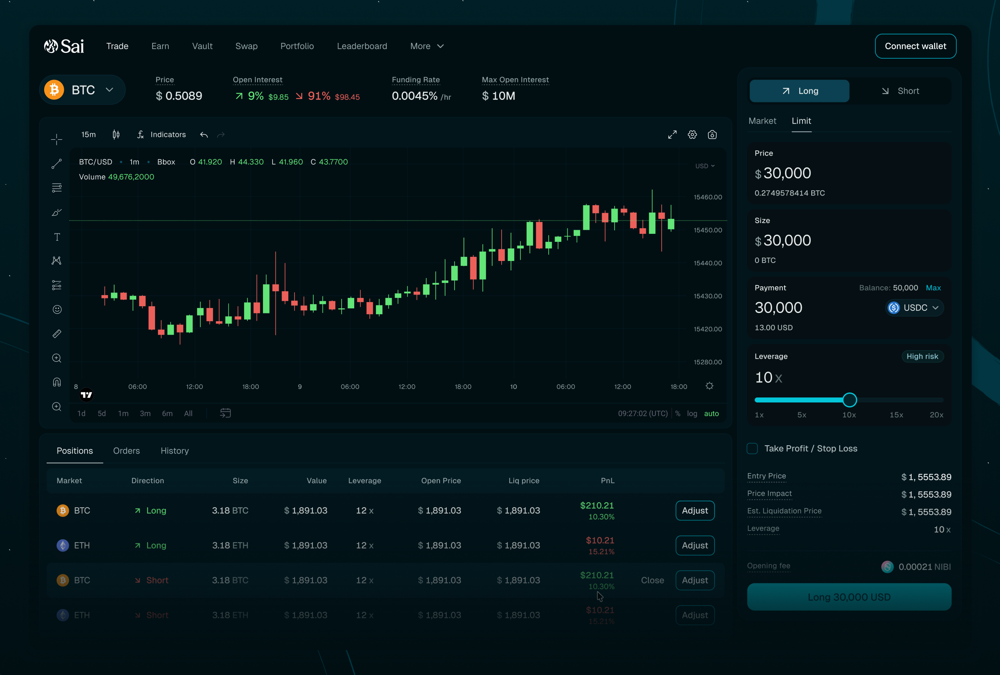
  </picture>
  <figcaption>Sai’s Trading Interface</figcaption>
</figure>

## What Traders Get with Sai

<figure>
  <picture>
    <source
      srcset="
        ../.gitbook/assets/blog_1/003_sai-fair-pricing-concept.png
      "
      media="(prefers-color-scheme: dark)"
    />
    
  </picture>
  <figcaption>Fair Pricing Concept</figcaption>
</figure>

<figure>
  <picture>
    <source
      srcset="
        ../.gitbook/assets/blog_1/004_sai-funding.png
      "
      media="(prefers-color-scheme: dark)"
    />
    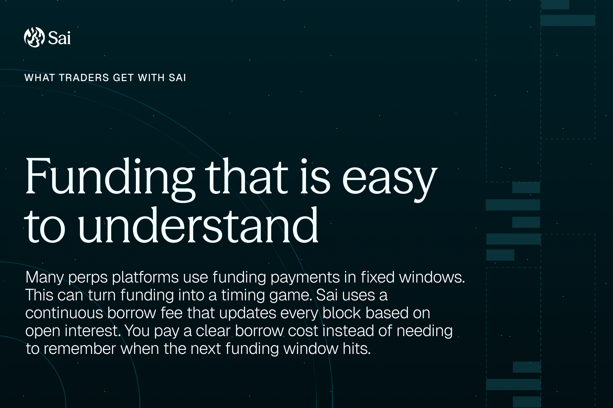
  </picture>
  <figcaption>Sai’s Funding</figcaption>
</figure>

<figure>
  <picture>
    <source
      srcset="
        ../.gitbook/assets/blog_1/005_sai-collateral.png
      "
      media="(prefers-color-scheme: dark)"
    />
    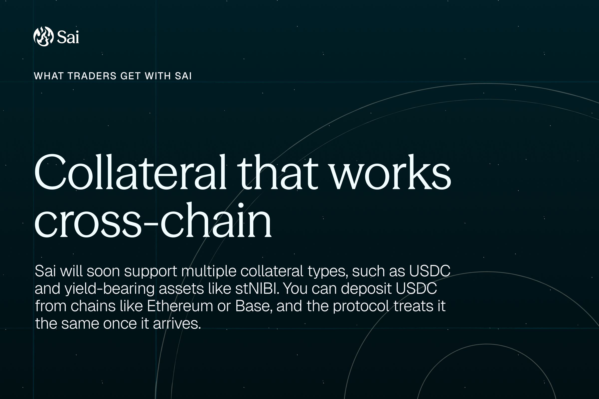
  </picture>
  <figcaption>Sai’s Collateral</figcaption>
</figure>

<figure>
  <picture>
    <source
      srcset="
        ../.gitbook/assets/blog_1/006_sai-in-practice.png
      "
      media="(prefers-color-scheme: dark)"
    />
    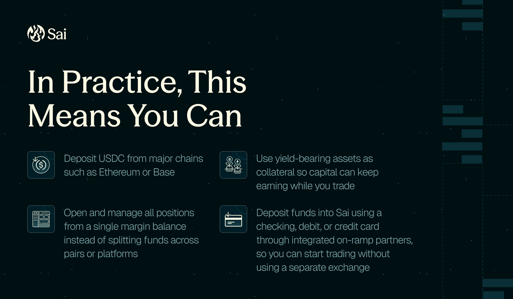
  </picture>
  <figcaption>In Practice</figcaption>
</figure>

### How Sai compares to other platforms

Under the hood, Sai is built around a simple question: what would the best perpetual platform look like if it was designed from scratch?

| Platform Type | Common Issues | Impact on Traders |
|---|---|---|
| Centralized Perp Exchanges | Custody risk, opaque liquidation logic, possible withdrawal limits | Funds are not fully under user control |
| AMM Style Perp DEXs | Funding games, skewed vaults, limited markets | Unclear costs, LPs take uneven risk |
| Hybrid Off-Chain Engines | Extra trust in sequencers or keepers, downtime risk | Users rely on a middle layer instead of the chain itself |
| Sai | Oracle settled pricing, continuous borrow fee, single asset vaults, flexible collateral | Fairer fills, more predictable costs, clear roles for traders and LPs |

<figure>
  <picture>
    <source
      srcset="
        ../.gitbook/assets/blog_1/007_sai-compare.png
      "
      media="(prefers-color-scheme: dark)"
    />
    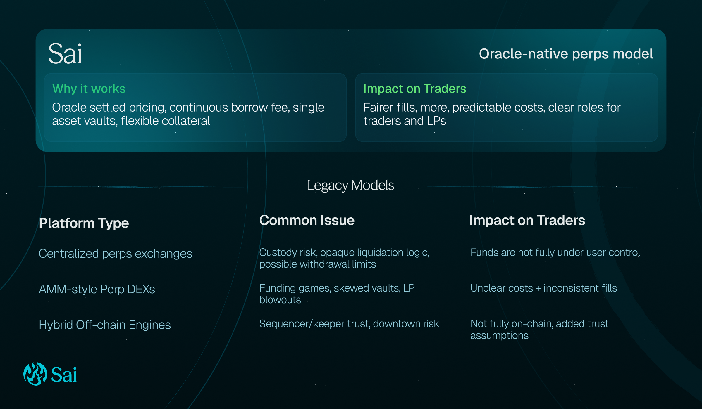
  </picture>
</figure>

Sai tries to answer a simple question: what would a best perpetual DEX look like if it stayed fully onchain and focused on a small set of strong ideas.

[See how trading works on Sai](https://docs.sai.fun/).

## Sai’s Key Design Choices

Under the hood, Sai is meant to be simple.

<figure>
  <picture>
    <source
      srcset="
        ../.gitbook/assets/blog_1/008_sai-features.png
      "
      media="(prefers-color-scheme: dark)"
    />
    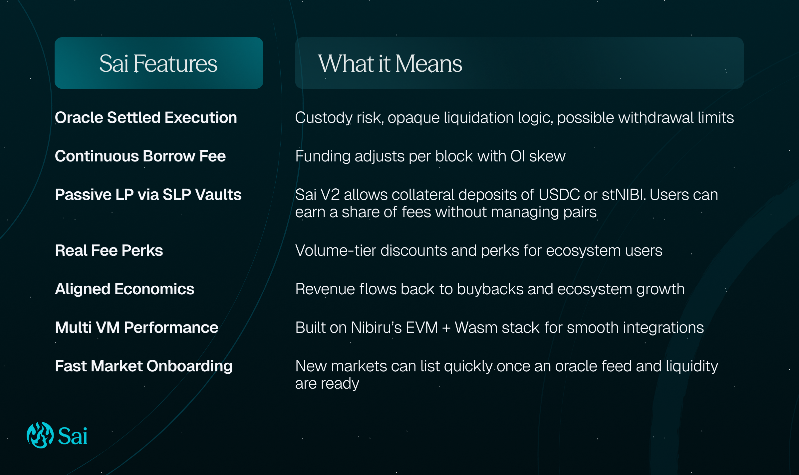
  </picture>
</figure>

## How Does Sai Handle Liquidations?

Liquidations are where most perp platforms break during liquidity crunches. [The Oct 10 flash crash](https://www.coindesk.com/opinion/2025/12/02/why-the-market-crashed-on-october-10-and-why-it-s-struggling-to-bounce) showed how a sharp move on one venue can trigger a chain of forced closes, even when the broader market never truly traded there.

Sai liquidates using onchain rules and a global oracle price, not a thin local order book. Validator feeders pull prices from multiple venues using a commit then reveal flow. The chain only accepts updates when participation clears a threshold, then publishes a weighted median price. If data is stale or participation is low, Sai uses the last good price and caps large moves so a single bad update does not snowball into unfair liquidations.

Liquidation is meant to be a last resort. Sai uses a deep buffer, with liquidations only triggering once losses and fees have consumed roughly 90 percent of posted collateral. Your liquidation price is deterministic and includes fees, so it is predictable. If you set a stop loss that would exit earlier than liquidation, Sai prioritizes the stop loss instead of forcing a liquidation. Any remaining collateral after closing costs is returned to the trader.

### Built for stress

- Oracle guardrails (multi source median, participation checks, last good price fallback, capped large moves)
- Exposure limits so single markets do not get dangerously crowded
- Stop loss checks so orders cannot be set in a way that only triggers after liquidation
- Onchain enforcement with permissionless triggering, so execution stays fast and transparent when markets move quickly

## Sai as an All-Market Platform

With oracle based pricing and pooled SLP liquidity, Sai can list any asset that has a reliable price feed and strong market demand.

<figure>
  <picture>
    <source
      srcset="
        ../.gitbook/assets/blog_1/009_sai-new-markets.png
      "
      media="(prefers-color-scheme: dark)"
    />
    
  </picture>
</figure>

What this unlocks for traders:

<figure>
  <picture>
    <source
      srcset="
        ../.gitbook/assets/blog_1/010_sai-unlocks-for-traders.png
      "
      media="(prefers-color-scheme: dark)"
    />
    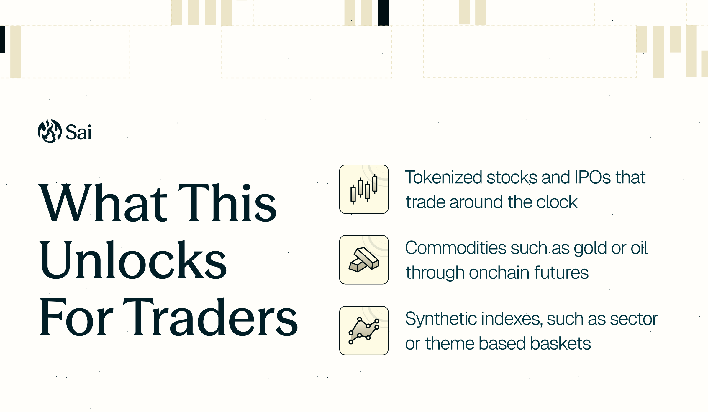
  </picture>
</figure>

For many users, this is what a modern decentralized derivatives exchange should look like: one adaptable venue always ready for the next phase of decentralized finance.

<figure>
  <picture>
    <source
      srcset="
        ../.gitbook/assets/blog_1/011_sai-unlocks-for-lp.png
      "
      media="(prefers-color-scheme: dark)"
    />
    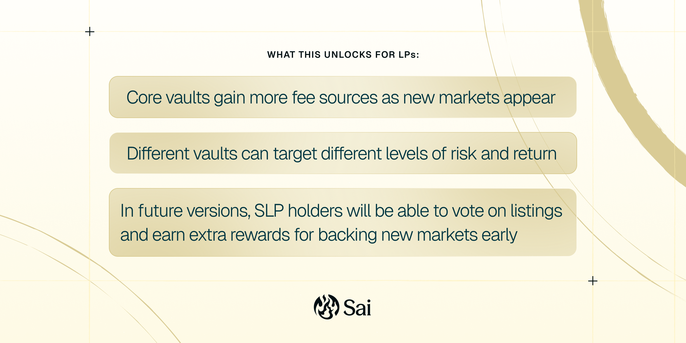
  </picture>
</figure>

Sai contributors and the community will surface high-potential assets to list. Users can propose and vote on new markets, keeping listings aligned with real demand. When interest is strong, the protocol can seed initial liquidity so trading can start immediately without relying on external market makers.

## Earning with Sai Liquidity Provision (SLP)

SLPs earn trading fees by providing liquidity through single asset vaults. Vaults can be segmented by volatility profile, giving LPs more control over exposure. At launch, deposits in USDC and stNIBI are supported.

<figure>
  <picture>
    <source
      srcset="
        ../.gitbook/assets/blog_1/012_sai-lp-vaults.png
      "
      media="(prefers-color-scheme: dark)"
    />
    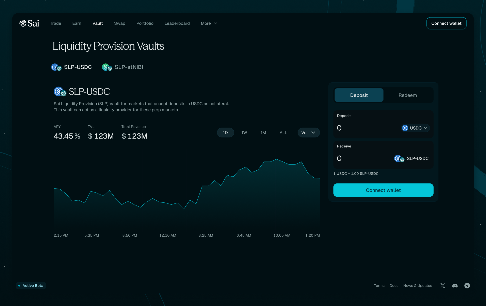
  </picture>
  <figcaption>Risk note: SLPs are the counterparty to traders. When traders profit, vaults can take losses. When traders lose, LPs earn fees.</figcaption>
</figure>

Each vault will support a curated basket of markets, ranging from bluechips to volatile assets to RWAs.

<figure>
  <picture>
    <source
      srcset="
        ../.gitbook/assets/blog_1/013_sai-vault-concept.png
      "
      media="(prefers-color-scheme: dark)"
    />
    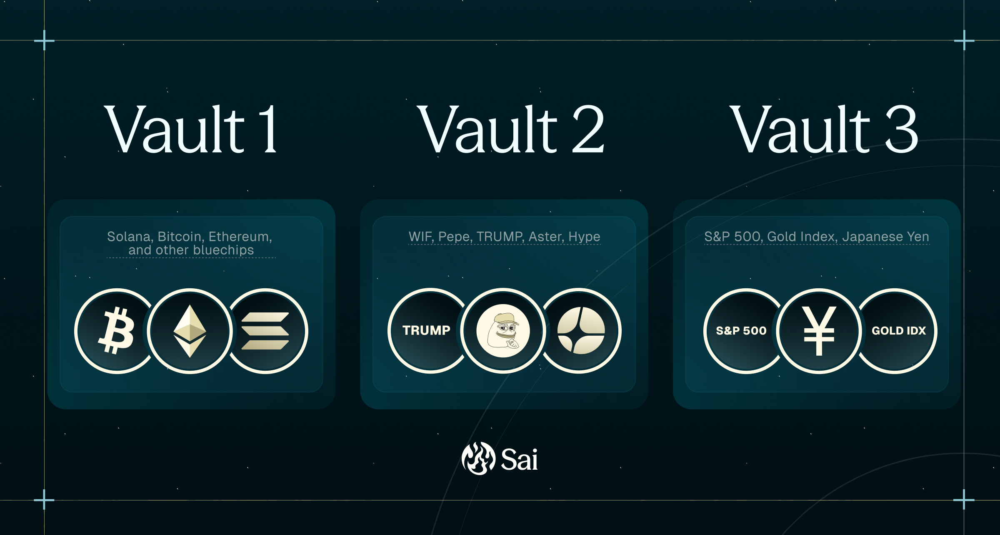
  </picture>
</figure>

[Provide liquidity for Sai - app.sai.fun.](https://app.sai.fun/buy-SLP/) 

## Sai Roadmap (2026)

Sai will continue shipping in three main verticals: more markets, better tools, and deeper yield.

<figure>
  <picture>
    <source
      srcset="
        ../.gitbook/assets/blog_1/014_sai-roadmap.png
      "
      media="(prefers-color-scheme: dark)"
    />
    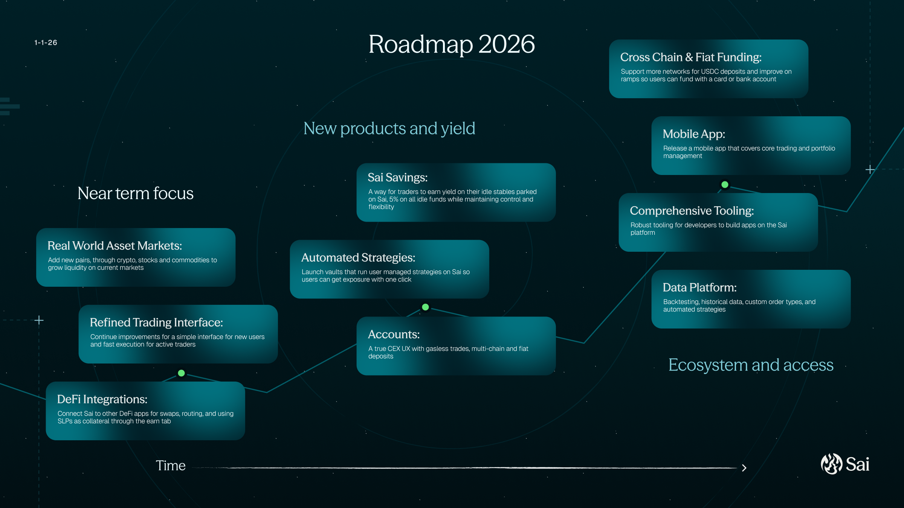
  </picture>
</figure>

### Near term focus

- **Real world asset markets:** Add new pairs, through crypto, stocks and commodities to grow liquidity on current markets
- **Refined trading interface:** Continue improvements for a simple interface for new users and fast execution for active traders
- **DeFi integrations:** Connect Sai to other DeFi apps for swaps, routing, and using SLPs as collateral through the earn tab

### New products and yield

- **Sai Savings**: A way for traders to earn yield on their idle stables parked on Sai, 5% on all idle funds while maintaining control and flexibility
- **Automated strategies:** Launch vaults that run user managed strategies on Sai so users can get exposure with one click
- **Accounts:** A true CEX UX with gasless trades, multi-chain and fiat deposits

### Ecosystem and access

- **Cross chain and fiat funding:** Support more networks for USDC deposits and improve on ramps so users can fund with a card or bank account
- **Mobile app:** Release a mobile app that covers core trading and portfolio management
- **Comprehensive tooling:** Robust tooling for developers to build apps on the Sai platform
- Data platform: Backtesting, historical data, custom order types, and automated strategies

Sai’s vision is simple: a platform that matches CEX scale while staying transparent and onchain, and expands into whatever markets traders demand.

If you haven’t already, follow Sai on socials to stay tuned for the latest updates, including beta testing, launch date, and more.
