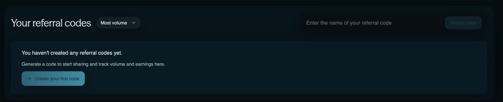
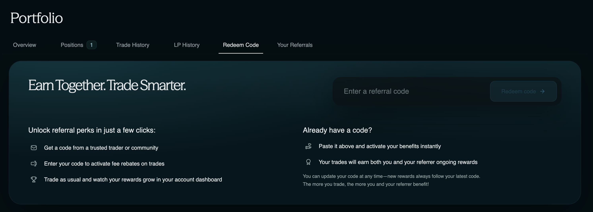

# How Referrals Work on Sai

<!--toc:start-->

- [How Referrals Work on Sai](#how-referrals-work-on-sai)
  - [Overview](#overview)
  - [Earn by Inviting Traders](#earn-by-inviting-traders)
    - [How It Works](#how-it-works)
      - [1) Create a Referral Code](#id-1-create-a-referral-code)
      - [2) Redeem a Referral Code](#id-2-redeem-a-referral-code)
  - [Commission Structure](#commission-structure)
    - [Referral Commission Tiers](#referral-commission-tiers)
  - [Trading Fee Discounts](#trading-fee-discounts)
  - [Get Started](#get-started)
  - [Need Help?](#need-help)
  <!--toc:end-->

## Overview

Sai's referral program offers a win-win opportunity for both referrers and traders:

1. **Redeem a referral code** to receive trading fee discounts on every trade
2. **Share a referral code** to earn a percentage of trading fees generated by traders you refer


**Key Benefit:** Referrers earn commissions while referred traders save on fees—everyone wins!


## Earn by Inviting Traders

When traders use your referral code to trade on Sai, you earn a share of the trading fees they generate. At the same time, traders who redeem your code receive discounted trading fees, creating a mutually beneficial relationship.

### How It Works

#### 1) Create a Referral Code

- **Create and share:** Generate a unique referral code or link and share it with your community through social media, Discord, Telegram, or any platform
- **Earn commissions:** When someone trades using your code, you automatically earn a percentage of the trading fees they pay
- **No impact on your fees:** Your own trading fees remain unaffected—you only earn commissions from referred traders' activity on Sai


**Pro Tip:** The more active traders you refer, the more you earn. Focus on quality referrals who will actively trade on the platform.


#### 2) Redeem a Referral Code

- **Instant savings:** Traders who redeem a code receive a percentage discount on trading fees for every trade, up to a certain amount (e.g., $10,000,000 in total trading volume)
- **Automatic application:** The discount applies automatically to all your trades—no need to manually apply it each time
- **No volume requirements:** Unlike some platforms, the discount is not tied to your personal trading volume

## Commission Structure

Sai offers a competitive commission structure designed to incentivize platform growth and reward active community builders. When a user redeems your code, you receive a baseline **15% commission** on the revenue generated by their trading fees.

### Referral Commission Tiers

Referrers can earn an increasing share of referred traders' fees based on their tier level:

| Tier   | Commission Rate | Eligibility           |
| ------ | --------------- | --------------------- |
| Tier 1 | 5%              | Entry level           |
| Tier 2 | 10%             | Active referrers      |
| Tier 3 | 15%             | High-volume referrers |
| VIP    | Up to 50%       | Exclusive partners    |


**VIP Partnership:** To qualify for VIP tier commissions (up to 50%), please contact the Sai team to discuss partnership opportunities.


## Trading Fee Discounts

Trading fee discounts **do not stack**. Traders automatically receive whichever discount is higher:

- **Volume-based discounts:** Earned from 30-day trading activity on the platform
- **Referral code discount:** 15% off trading fees when redeeming a valid referral code

This ensures you always get the best possible rate on your trades.

## Get Started

Follow these simple steps to start earning or saving today:

### 1. Create a referral code and share it with your audience

<figure>
  <picture>
    <source
      srcset="
        ../.gitbook/assets/guides/000_create_code.png
      "
      media="(prefers-color-scheme: dark)"
    />
    
  </picture>
  <figcaption>Navigate to the Referrals page to create your unique code</figcaption>
</figure>

### 2. Redeem a referral code to start saving on trading fees

<figure>
  <picture>
    <source
      srcset="
        ../.gitbook/assets/guides/001_redeem_code.png
      "
      media="(prefers-color-scheme: dark)"
    />
    
  </picture>
  <figcaption>Enter a referral code to unlock instant trading fee discounts</figcaption>
</figure>

### 3. Trade, track your activity on the leaderboard, and climb tiers over time

Monitor your referral performance and earnings directly from your dashboard. As your referred traders become more active, you'll automatically progress through commission tiers and earn higher rewards.

---

## Need Help?

If you have questions about the referral program or need assistance getting started, reach out to our community.

**Resources:**

- 🐦 [X / Twitter](https://x.com/SaiDotFun) - @SaiDotFun
- 📢 [Telegram News Channel](https://t.me/saidotfun) - t.me/saidotfun
- 📸 [Instagram](https://instagram.com/saidotfun) - instagram.com/saidotfun
- 🎵 [TikTok](https://www.tiktok.com/@saidotfun) - @saidotfun

---

_Last updated: February 2026_
