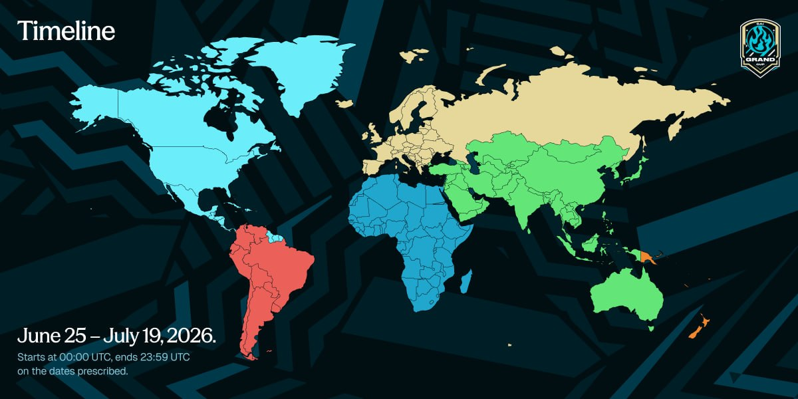
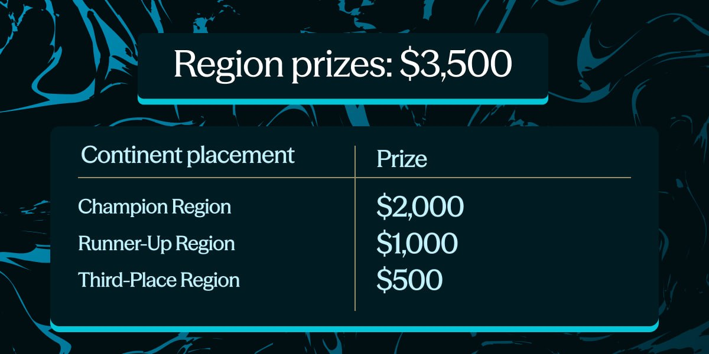
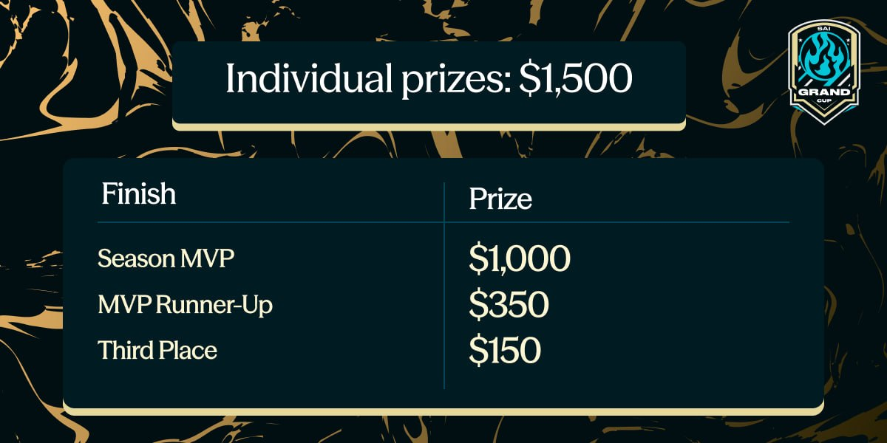

# 08 - Sai Grand Cup 2026: Trade for Your Region

Sai Grand Cup is a month-long, team-based trading competition running alongside this summer's biggest football tournament. Instead of trading solo, you're assigned a region based on your trading history, and your activity contributes to that continent's position on the leaderboard. Traders are assigned to a country automatically. When the competition ends, the top continents split a team prize pool, and the best individual traders earn separate rewards.

If you already trade on Sai, this is a way to put your trading to work. If you're new, it's the easiest time to start: every qualifying trade also earns Sai Points.

### Timeline

<figure><figcaption></figcaption></figure>

The competition runs June 25 – July 19, 2026. Each day starts at 00:00 UTC and ends at 23:59 UTC on the dates prescribed. Winners are announced after the leaderboard closes, sometime after July 19th. Your continent is assigned based on your historical trading volume and is locked for the duration of the competition.

### How the Competition Works

Region rankings are determined by a combination of realized PnL, trading volume, and active traders. Profitable trading, sustained activity, and team participation all matter.

**Worked example:**

| Region        | **Realized PnL** | **Volume** | **Active Traders** | **Result** |
| ------------- | ---------------- | ---------- | ------------------ | ---------- |
| Asia          | $50,000          | $5,000,000 | 15                 | 1st        |
| Europe        | $55,000          | $2,000,000 | 8                  | 2nd        |
| South America | $40,000          | $6,000,000 | 20                 | 3rd        |

Asia brought the highest PnL, but Europe won on a stronger balance of profitability, volume, and participation.

_**Tie-breakers, in order:** higher total realized PnL, then higher total volume, then more qualifying traders._

### Prize Pool: $5,000 USDC credits

Rewards split into a region and an individual pool.

**Region prizes: $3,500**\
Split among a continent's qualifying traders, weighted by each trader's contribution to the region’s final score.

<figure><figcaption></figcaption></figure>

**Individual prizes: $1,500**\
Awarded to the top individual traders across the full competition, regardless of region.

<figure><figcaption></figcaption></figure>

Rewards are paid in USDC credits on the Sai platform (non-withdrawable until a certain trading-activity threshold is reached). Final rewards may be adjusted based on eligibility, wash-trading checks, and competition rules.

### How to qualify

To count toward your continent's score and be eligible for prizes:

* Connect your wallet to Sai’s Trading App
* Go to “Compete” | [https://app.sai.fun/leaderboard/](https://app.sai.fun/leaderboard/)

<figure><figcaption></figcaption></figure>

* New to Sai? Deposit at least $100 in margin to get started
* If you're an existing Sai user and have traded before (at least $100 in margin), you're eligible to participate.

That's it to enter. From there, your trading volume and realized PnL feed your region’s score for the rest of the competition.

### Grand Cup Stacks with Sai Points

The Grand Cup runs on top of the [Sai Points Program](https://app.sai.fun/?ref=POINTS). Every qualifying trade during the Cup still earns Points across all the usual activities, plus Cup-specific boosts:

* Boosted points on all qualifying trades during the event window
* Football-themed weekly bounties slotted into the regular bounty cadence
* A loyalty booster for traders active across all weeks of the Cup

So a single trade during the Cup can move your continent up the leaderboard and grow your personal Points total at the same time.

More details on Sai Points will be provided soon.

### Rules and eligibility

* **How to enter:** Any Sai user who trades with under a region.
* **Eligibility:** open to traders 18 or older who are not residents of restricted jurisdictions, as set out in Sai's [Terms of Use](https://docs.sai.fun/resources/legal/terms-of-use). Traders in the United States or other sanctioned regions are **not** eligible. By entering, you confirm you are abiding by all local laws and the platform's terms.
* **Competition duration:** the competition starts at 00:00 UTC and ends at 23:59 UTC on the prescribed dates.
* **Unique accounts only:** one account per person. Any form of sybil attack (multiple accounts by the same person) is prohibited. Each participating account must be funded from a unique source; funding multiple wallets to gain an unfair advantage results in disqualification.
* **No wash trading or fake volume:** wash trading, self-dealing, and fake volume generation are forbidden. Self-trades or coordinated trades between colluding accounts to inflate volume or PnL result in immediate disqualification. Sai monitors trade patterns and reserves the right to disqualify or ban abusive accounts.
* **No bot manipulation:** fair-use trading bots are allowed, but malicious bot-driven manipulation is prohibited and offending trades will be voided.
* **Minimum holding time:** a minimum position hold time may be required for a trade to count toward volume. Positions held open below that time may not count.
* **Leaderboard updates:** leaderboards update regularly so you can track your country's standing.
* **Minimum activity threshold:** if the competition does not reach a minimum level of activity, as determined by the Sai team, Sai reserves the right not to distribute some or all of the prizes. If there are fewer qualifying participants than prizes available, all qualifying participants may earn a prize and Sai may redistribute or withhold remaining prizes at its discretion — meaning the full planned pool may not be distributed.
* **Reward distribution:** winners are announced after the competition closes, with instructions on how to receive rewards. Payouts are distributed within a reasonable timeframe.
* **Integrity and auditing:** Sai monitors the competition and may audit activity, disqualify participants, and adjust or remove suspicious entries to ensure a level playing field. All decisions are final.
* **Participation is at your own risk:** trading perps is inherently risky. You participate at your own risk and release Sai from any claims. Sai is not responsible for any loss of assets or value. Even experienced traders can lose their entire balance. If you're not experienced with platforms like this, you should not participate.
* **Your own legal and tax situation:** you are responsible for any tax or legal issues arising from participation, and represent that no jurisdiction with authority prohibits it.
* **Terms apply:** Sai's [Terms of Use](https://docs.sai.fun/resources/legal/terms-of-use) and Privacy Policy govern your participation, including Sections 21–25 (indemnification, governing law, arbitration and class-arbitration waiver, time to file claims, and waiver & severability). These terms supersede any promotional statements.

***

_Get in:_ [_app.sai.fun_](http://app.sai.fun)_. Every trade counts toward your team — and your Sai Points._
